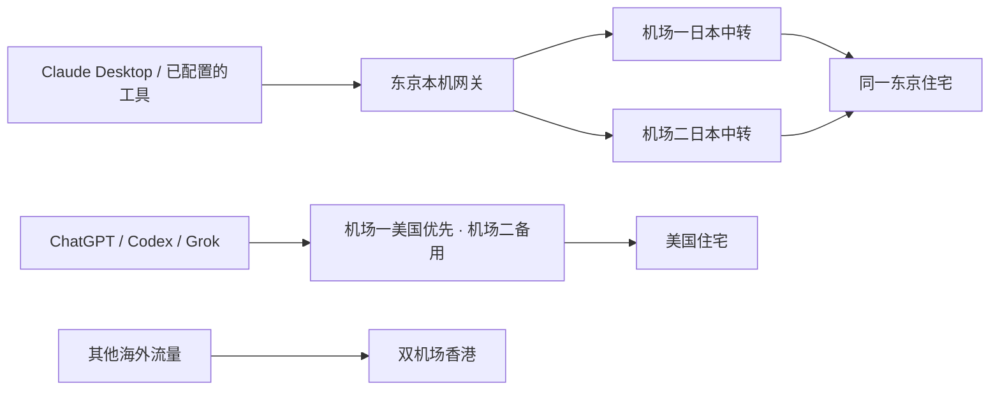

# Clash Verge macOS 模板

将双机场分流、美国住宅链路和 Claude 东京通道整理为可配置的本地工程。仓库只包含公开源码、虚构示例和测试；使用者提供自己的订阅、住宅账号及预期出口 IP。

**当前为 0.1.0 分享候选。** 已做源码回归、隔离解析及本机编译检查；尚未在另一台干净 Mac 完成管理员安装、真实出口、重启和登录验收。不要把“模板生成成功”当作“这台新电脑已受到保护”。详见 [验证记录](docs/VERIFICATION.md)。

## 两个层级

| 层级 | 功能 | 依赖 |
|---|---|---|
| `basic` | 双机场；美国主备中转 → 美国住宅；两条日本中转 → 同一东京住宅；应用和域名分流 | 支持相关字段的 Mihomo／Clash Verge；需按实际版本验证 |
| `macos` | 基础分流＋独立东京网关、核验出口、故障锁定、符合条件后恢复、菜单栏状态灯、登录后预检 | macOS、Node 22+、Clash Verge/Mihomo、Xcode Command Line Tools |

可选模块：独立 Chrome、防护扩展、登录链接接管、Claude 工具分流，以及 Claude 调用 Codex 时单独使用美国线路。登录接管的系统原生认证窗口路径尚未验收，默认不开启。



东京不可用时，网关拒绝连接，没有机场裸出口或 DIRECT 选项。自动恢复只处理明确的暂时故障；人工锁定、规则变化、出口不符保持锁定。这里是应用代理与 TUN 规则配合，**不是独立于 Clash 的整机防火墙**，也不是账户或设备指纹隔离工具。

## 先离线体验

```sh
node scripts/toolkit.mjs init --out .private/config.json
# 编辑自己的私有配置；示例不能部署。
node scripts/toolkit.mjs render --config examples/config.example.json --out .private/demo --demo
npm test
npm run audit:public
```

这些命令不安装服务、不改当前 Clash、不切换默认浏览器、不连接机场。安装和卸载入口不带 `--apply` 时只显示计划。

正式步骤见 [安装指南](docs/INSTALL.md)；配置项见 [配置与更新](docs/CONFIGURATION.md)；授权与保护范围见 [边界](docs/BOUNDARIES.md)。

## 分享

```sh
npm run check
npm test
npm run audit:public
npm run pack:public
```

只分享 `dist/clash-verge-macos-template-0.1.0.zip`。导出严格使用 `PUBLIC-FILES.json` 清单，包含源码而不包含 Node/Mihomo 可执行文件；`.private`、安装包、浏览器数据、回执和 Git 历史不会进入压缩包。首次修改公开文件集后必须人工复核并更新清单。已存在的同名导出不会被覆盖。

不要直接压缩工作目录，也不要分享生成的 `main.private.yaml`。它含有使用者自己的订阅和代理凭据。

## 工程组织

- `src/`：配置生成、东京故障状态机、安装包校验与本机操作。
- `templates/`：按使用者身份生成的 macOS 服务、原生应用和工具入口。
- `examples/`：仅保留文档专用 IP、`.invalid` 域名和无效凭据。
- `tests/`：隔离的状态机、路由、参数化、隐私和安装包测试。
- `.private/`：使用者私有输入与测试／安装产物，已排除分享。

本地模板不等于已公开开源发布。许可状态与第三方说明见 [许可说明](LICENSE-NOTICE.md)和[第三方清单](THIRD-PARTY-NOTICES.md)。
